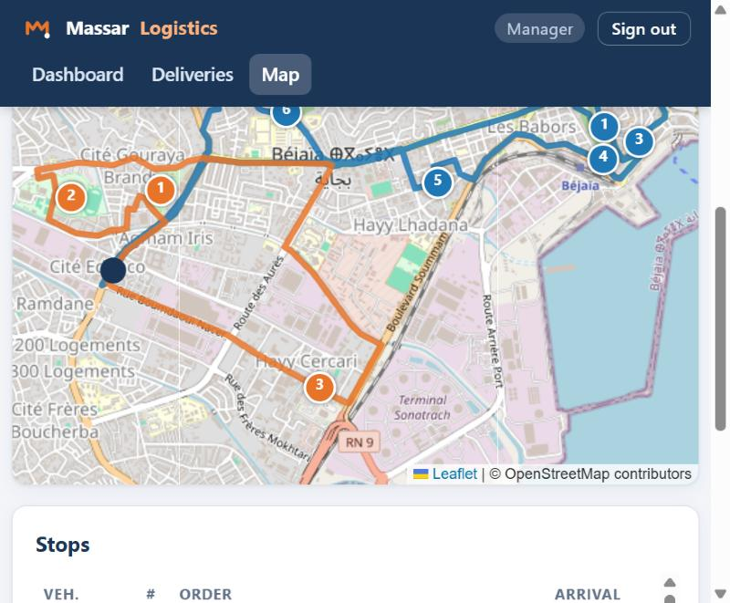
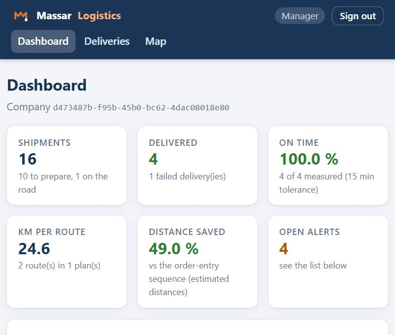
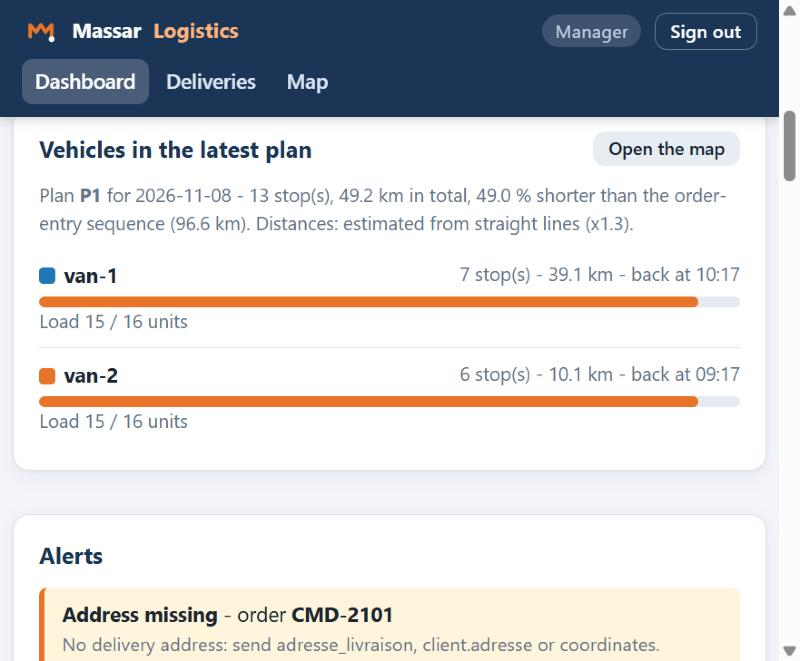
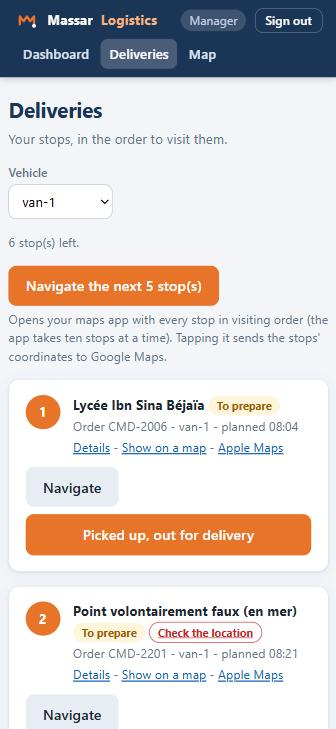
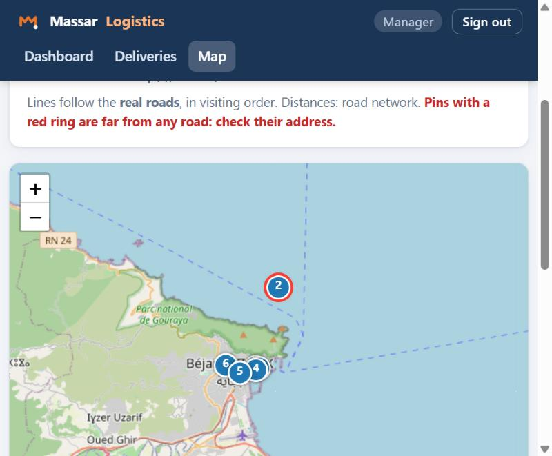
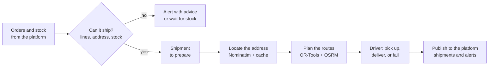

<div align="center">

# Massar Logistics Agent

**Every confirmed order with stock becomes a planned, optimized and tracked delivery.**

*Chaque commande en stock devient une expédition planifiée, optimisée et suivie.*




</div>

An autonomous service for a multi-company business platform. It receives **orders** and **stock levels**, decides which orders can ship, finds where to deliver, plans the **shortest routes on the real road network**, follows every delivery until it is done, and tells the rest of the platform what happened. It runs in its own Docker container, talks to the platform only through its exchange bus, and keeps every company's data strictly apart.

Built by Team Massar (ESTIN, 2nd year) for the *Conduite de projet* mini-project.

---

## What it does

| | |
|---|---|
| **Receives** | Orders (`commande`) and stock levels (`stock_level`), pushed by the platform or pulled on demand |
| **Decides** | Which orders can ship: valid lines, a known address, enough stock. The rest raise a clear alert, or wait for stock |
| **Locates** | Turns addresses into coordinates (OpenStreetMap Nominatim, cached, polite). Manual correction when an address is wrong |
| **Plans** | Google OR-Tools builds routes per vehicle within capacity and working hours, on real roads with OSRM, and shows the distance saved |
| **Tracks** | `preparation` → `en_transit` → `livree` or `retour`, with a timestamped history, failure reasons and automatic rescheduling |
| **Reports** | Publishes every shipment (`expedition`) and every alert to the platform; retries on its own if the platform is down |
| **Protects** | Strict isolation between companies, a full purge on deactivation, hashed access codes, a hardened container |

## See it

<table>
<tr>
<td width="50%"><br><sub><b>Dashboard.</b> On-time rate, kilometres per route, distance saved, open alerts.</sub></td>
<td width="50%"><br><sub><b>Plan and alerts.</b> How full each van is, and what needs attention with advice.</sub></td>
</tr>
<tr>
<td width="50%"><br><sub><b>Driver page.</b> Stops in order, big buttons, one-tap navigation in the phone's maps app.</sub></td>
<td width="50%"><br><sub><b>Location check.</b> A point far from any road is flagged before a driver is sent there.</sub></td>
</tr>
</table>

## Quick start

You need Docker. Nothing else is required to try the agent.

```bash
cp .env.example .env                  # then set CORE_URL (see below)
docker compose up --build -d          # the agent on http://localhost:9000
curl http://localhost:9000/health     # {"status":"ok","data":{...},"error":null}
```

**1. Connect it to the platform core.** The core (authentication, companies, the exchange bus) is provided by the course instructor and is not part of this repository. [Running the agent with the platform core](docs/Running-with-the-platform-core.md) walks through it. When a company subscribes, the core activates it on the agent.

**2. Give people access.** The operator creates a manager code and a driver code for the company (shown once):

```bash
curl -X POST http://localhost:9000/tenant/<company-id>/access-codes \
  -H "X-Tenant-Id: <company-id>" -H "Authorization: Bearer <company-key>"
```

People then sign in at `http://localhost:9000/ui/login?tenant=<company-id>`.

**3. Optional: the real road network.** Without it the agent estimates distances from straight lines and cannot see roads on the map. With it you get real distances and times, route lines along the streets, and detection of points in the sea.

```bash
.\scripts\prepare_osrm.ps1            # or: sh scripts/prepare_osrm.sh   (301 MB download, about 10 minutes, once)
# in .env:  OSRM_URL=http://osrm:5000   and   COMPOSE_PROFILES=routing
docker compose up -d
```

## How it works



The whole story, with diagrams for each step, is in [How the agent works](docs/How-the-agent-works.md).

## Documentation

| I want to... | Read |
|--------------|------|
| **Understand** what it does and why | [How the agent works](docs/How-the-agent-works.md) |
| **Use** the dashboard, the map or the driver page | [User guide](docs/User-guide.md) |
| **Connect** a program to it | [API reference](docs/API-reference.md) |
| **Run** it with the platform core | [Running with the platform core](docs/Running-with-the-platform-core.md) |
| **See how it was built** and tested, step by step | [Iteration notes](docs/how-it-works/README.md) |
| **Check how safe it is** | [SECURITY.md](SECURITY.md) and the [security review](docs/how-it-works/iteration-8-security-review.md) |
| **Browse everything** | [Documentation home](docs/README.md) |

## Operations API

For the platform operator and scripts. Everything is under `/tenant/{tenant_id}` with the headers `X-Tenant-Id` and `Authorization: Bearer <company key>`. People use the web interface instead. The complete list, with examples, is in the [API reference](docs/API-reference.md).

| Route | Purpose |
|-------|---------|
| `GET /shipments`, `GET /shipments/{id}` | Shipments with their timestamped history |
| `POST /shipments/{id}/status` | Move a shipment along its life cycle (`en_transit`, `livree`, `retour` with a reason, and an optional new day) |
| `PUT /shipments/{id}/location` | Set coordinates by hand when an address cannot be located |
| `GET /orders`, `GET /alerts` | The decision taken for each order; what needs attention |
| `POST /plans`, `GET /plans`, `GET /plans/latest` | Plan routes now; read plans with stops, arrival times and distance saved |
| `GET /plans/{id}/paths` | The road line of each vehicle |
| `GET /indicators` | On-time rate, kilometres per route, distance saved, failures |
| `POST /access-codes`, `POST /sync` | Create the web interface's access codes; exchange with the platform now |

## Configuration

Everything is optional. Settings go in `.env` (see [`.env.example`](.env.example)); each company's own settings (depot, vehicles, working hours...) are sent by the platform when it subscribes.

| Variable | Purpose |
|----------|---------|
| `CORE_URL` | Address of the platform core, as seen from the container |
| `OSRM_URL` | Road-network service (empty: straight-line estimates) |
| `NOMINATIM_URL` | Address lookup (empty: off) |
| `MAINTENANCE_SECONDS` | Delay-alert and retry pass interval (default 300) |
| `SESSION_SECRET`, `SESSION_COOKIE_SECURE` | Sign-in cookie key; mark the cookie secure behind HTTPS |

## Repository layout

```
agent/
  app/                  the agent: contract endpoints, decision rules, planning, web interface
    templates/ static/  the pages and their stylesheet
  tests/                the automated tests
  Dockerfile  entrypoint.py  agent.manifest.json
docs/                   guides, API reference, iteration notes, screenshots
scripts/                prepare the road network, benchmark the optimizer, submit to the platform,
                        build a clean public copy
docker-compose.yml      the agent, and the optional road-network service
```

## Quality and safety

- **295 automated tests** cover the platform contract, the response format on every route, isolation between companies, deletion of a company's data (checked on the database file itself), the decision rules, planning, the web interface, concurrency and speed.
- **A 50-stop plan takes 5 seconds** and saves about 75 % of the distance on the synthetic benchmark (a deliberately naive baseline); on a real 9-stop plan on Algerian roads the saving was 37 %.
- CI runs `ruff`, the tests, `bandit` (code analysis) and `pip-audit` (known vulnerabilities in dependencies) and builds the Docker image on every push.
- The container runs without administrator rights. Read the [security policy](SECURITY.md), including what it does **not** do (for example it speaks plain HTTP: put it behind HTTPS).

```bash
cd agent
pip install -r requirements-dev.txt
pytest
ruff check .
```

## Built with

Python 3.12, FastAPI, SQLite, Jinja2 and htmx, Leaflet, Google OR-Tools, OSRM, OpenStreetMap, Docker and GitHub Actions. All free and open source (see [THIRD-PARTY-NOTICES.md](THIRD-PARTY-NOTICES.md)).

## History

| Version | What it added |
|---------|---------------|
| 0.1.0 | Repository, Docker, a skeleton that follows the platform contract |
| 0.2.0 | Activation on the platform, secret-key checks, validated company settings |
| 0.3.0 | Orders and stock in, shipping decisions, shipment life cycle, shipments published |
| 0.4.0 | Address lookup, route optimization, the distance-saved measure |
| 0.5.0 | Web interface: dashboard, map, driver page, indicators, alerts |
| 1.0.0 | The instructor's verification checklist as automated tests, execution report |
| 1.1.0 | Interface redesign, location checks, reliability fixes, full documentation |
| 1.2.0 | Navigation links for drivers, real road lines, regular housekeeping |
| 1.2.1 | Security review: dependency upgrades, request limits, protective headers, unprivileged container |

## Known limits

The agent does not reserve stock (the stock agent owns it), plans one day at a time with one working window per company, counts load in units, and hands turn-by-turn directions to the driver's own maps app. Without the road network, distances are estimates. The full list is in [How the agent works](docs/How-the-agent-works.md#13-what-it-does-not-do) and [SECURITY.md](SECURITY.md).

## Licence

MIT, see [LICENSE](LICENSE). Third-party software and map data keep their own licences: see [THIRD-PARTY-NOTICES.md](THIRD-PARTY-NOTICES.md). The platform core this agent plugs into is not part of this repository.
