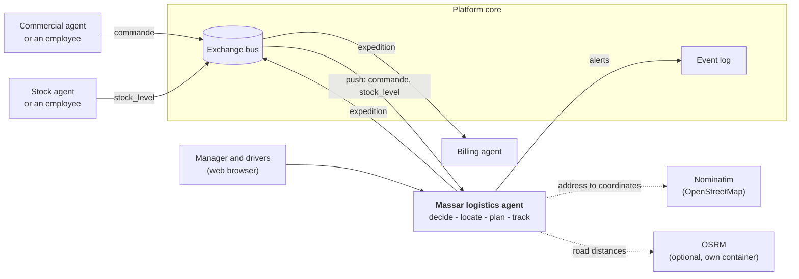
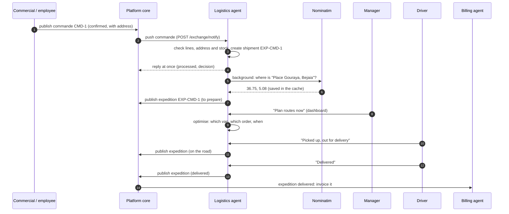
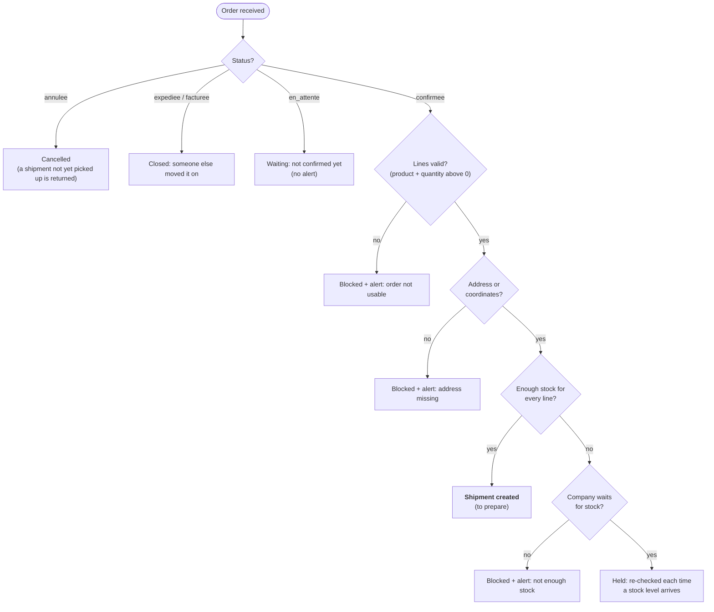
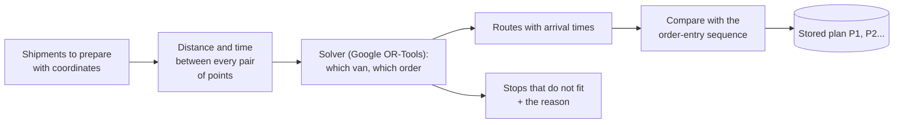
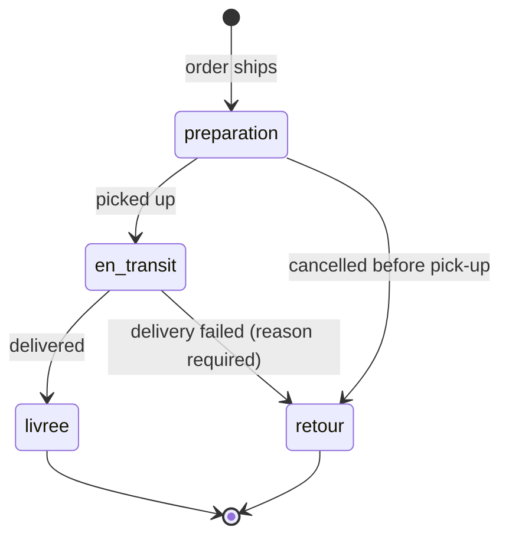

# How the Massar logistics agent works

> **In one sentence:** the agent takes every confirmed order that has stock and an address, turns it into a shipment, plans the shortest delivery routes for the day, follows each delivery until it is done, and tells the rest of the platform what happened.

This guide explains the whole agent in plain language, with diagrams. You do not need to read any code. If you want to *use* the agent, read the [User guide](User-guide.md); if you want to *connect* to it, read the [API reference](API-reference.md).

**Contents**

1. [The big picture](#1-the-big-picture)
2. [One order, from start to delivery](#2-one-order-from-start-to-delivery)
3. [Step 1: receiving orders and stock](#3-step-1-receiving-orders-and-stock)
4. [Step 2: deciding what can ship](#4-step-2-deciding-what-can-ship)
5. [Step 3: finding where to deliver](#5-step-3-finding-where-to-deliver)
6. [Step 4: planning the routes](#6-step-4-planning-the-routes)
7. [Step 5: delivering and following up](#7-step-5-delivering-and-following-up)
8. [Step 6: telling the platform](#8-step-6-telling-the-platform)
9. [People and access](#9-people-and-access)
10. [Companies stay apart](#10-companies-stay-apart)
11. [Settings of a company](#11-settings-of-a-company)
12. [What the indicators mean](#12-what-the-indicators-mean)
13. [What it does not do](#13-what-it-does-not-do)

---

## 1. The big picture

The agent is one small service that runs in its own container. It does not talk to other agents directly: everything goes through the **platform core** (the instructor's platform), which stores and routes the shared objects.

| Piece | Role |
|-------|------|
| **Commercial / Stock** | Produce the *orders* (`commande`) and *stock levels* (`stock_level`). If a company has not subscribed to those agents, an employee types them in the platform dashboard instead; the logistics agent works the same either way. |
| **Platform core** | Authentication, companies, the exchange bus. It pushes orders and stock to the agent and keeps the shipments the agent publishes. |
| **The agent** | The business logic described in this guide. |
| **Billing** | Reads the shipments to invoice delivered orders. If the logistics agent stops, billing is blocked, so availability matters. |
| **Nominatim** | Free OpenStreetMap service that turns an address into coordinates. Optional. |
| **OSRM** | Road-network engine that gives real driving distances. Optional; without it the agent estimates from straight lines. |

---

## 2. One order, from start to delivery

The important point: the agent **replies to the core immediately** and does the slow work (looking up addresses, publishing) afterwards, because the core only waits ten seconds for an answer.

---

## 3. Step 1: receiving orders and stock

Two ways in, one result:

| Way | When |
|-----|------|
| **Push** | The core calls the agent each time an order or a stock level is published (`POST /exchange/notify`). |
| **Pull** | The agent asks the core for what exists: at start-up, right after a company activates, and on demand (`POST /tenant/{id}/sync`). This catches anything missed while the agent was down. |

Rules applied to everything that arrives:

- The agent keeps the **latest version** of each object. A *late, older version* is ignored.
- Anything the agent does not know (extra fields, other object types) is **ignored, never an error**.
- Every call must carry the company's identifier and its secret key; a wrong key is refused and nothing is stored.

An order contains: its number, a status (`en_attente`, `confirmee`, `expediee`, `facturee`, `annulee`), a list of lines (product code `sku` and quantity), the client, and the **delivery address**. The platform's example order has no address field, so the agent reads it from optional fields (see [section 5](#5-step-3-finding-where-to-deliver)).

---

## 4. Step 2: deciding what can ship

Each time an order or a stock level changes, the agent decides about the affected orders:

Details that matter:

- **Stock** is counted per product code, adding up all warehouses. A product with no stock level at all counts as "stock unknown".
- The agent **does not reserve stock**: the Stock agent owns it. Two orders competing for the last units can both ship.
- A *blocked* order waits for a **new version** of the order (for example once the address is added). A *held* order is retried automatically when stock arrives.
- The same order arriving twice never makes two shipments.

---

## 5. Step 3: finding where to deliver

A route needs coordinates. The agent gets them, in this order of preference:

1. **Coordinates sent with the order** (`latitude`, `longitude`).
2. **The address text**, looked up on Nominatim. Lookups happen in the background right after the order arrives, at most **one per second**, with an identifying User-Agent, and every answer is **cached** (per company) so the same address is never asked twice, even when a burst of orders arrives together.
3. **By hand**: when an address cannot be found, the manager types the coordinates on the shipment page.

If geocoding is off or the address is unknown, the shipment gets an alert (`address_not_found` or `address_not_located`) and is left out of plans until it has a location.

The address is read from the order's `adresse_livraison` (text, or an object with street, postcode, town...), then from `client.adresse`.

### Why a point can appear in the sea

The map draws **exactly the coordinates it was given**. A pin in the water means the coordinates are wrong: a typo, a vague address that matched the wrong place, or invented test data. The agent cannot tell sea from land on its own. It has two defences:

- **With the road network (OSRM)**, each point is attached to the nearest road. A point more than **500 m** from any road is flagged: the plan lists it, the map marks it with a red ring, the driver's page marks the stop "Check the location", and a *suspicious location* alert asks someone to check it. (Checked on the real Algeria map: a point in the Bay of Béjaïa came out 3.4 km from the nearest road.)
- **Always available**: the manager can correct the coordinates on the shipment page; the alert closes and the next plan uses the new point.

---

## 6. Step 4: planning the routes

When the manager presses **Plan routes now** (or calls `POST /tenant/{id}/plans`), the agent plans every shipment still *to prepare*.

**Distances.** With OSRM the agent uses real road distances and driving times, and also stores the **road line** of each van's route so the map can follow the real streets. Without it, it uses straight lines **multiplied by 1.3** (roads are longer than the crow flies) at an assumed 35 km/h, and the map joins the stops with straight lines. The plan always says which one it used.

**What the solver respects:**

| Constraint | Source |
|------------|--------|
| Every van starts and ends at the **depot** | company settings |
| A van never carries more than its **capacity** (units = sum of line quantities) | company settings |
| A van is **back before the end of the working day** | working hours |
| Each stop takes a **stop duration** | company settings |
| An order wanted on a **later day** is not planned today | `date_livraison_souhaitee`, or a rescheduled delivery |

It minimises the **total distance**, within a time limit (3 s from the dashboard, 5 s by default, 30 s at most).

**Stops left out** are never dropped silently. Each gets a reason and an alert:

| Reason | Meaning |
|--------|---------|
| it has no coordinates yet | locate it first |
| its load is bigger than every vehicle | needs a bigger vehicle or a split |
| the round trip alone is longer than the working day | too far for one day |
| no vehicle had enough capacity or time left | add a van or hours, or deliver another day |

**The gain.** To show the value of optimising, every plan is compared with the *order-entry sequence*: the same stops, visited in the order the orders were entered, filling vans one after another, with no optimisation. The result is shown as "distance saved". On the synthetic 50-stop test the saving is about 75 %, but that baseline is deliberately naive (random addresses in random order), so real orders will show a smaller gain.

---

## 7. Step 5: delivering and following up

**Getting there.** The agent decides the *order* of the stops and which van takes them; the driver's phone decides the *turns*. Each stop has a **Navigate** button, and a whole van has a **Navigate the next stops** button, that open the phone's own maps app with directions from the driver's current position. That is how a driver sees the best way at that moment, including traffic if the maps app knows it. Stops flagged as far from any road are left out of that one-tap route.

A shipment moves through four states. Every move is recorded with a time (in UTC) and an optional note:

| State | Shown as | Meaning |
|-------|----------|---------|
| `preparation` | To prepare | Created, waiting to be picked up |
| `en_transit` | On the road | The driver has it |
| `livree` | Delivered | Done |
| `retour` | Returned | Came back (failed delivery or cancellation) |

**When a delivery fails.** The driver gives a reason (required) and may choose a new day. The agent then creates a **new shipment** for the same order (`EXP-CMD-1-R1`, then `-R2`...) with a "not before" date, so it appears in plans from that day on. The failed shipment stays in the history. If the order is later cancelled, the new shipment is cancelled too.

**Punctuality.** A delivery counts as *on time* if it happened no later than its planned arrival plus 15 minutes. A shipment still waiting or on the road past that limit raises a *running late* alert (checked every five minutes).

---

## 8. Step 6: telling the platform

| What | How | When |
|------|-----|------|
| **Shipments** | `expedition` objects published to the core's exchange bus, with the *same identifier each time* so the core keeps one object and counts versions | On creation and on every status change |
| **Alerts** | One event per open alert to the core's event log, with a severity (`high` for a failed delivery, `medium` for delays and unplanned stops, `low` for the rest) | Once per alert; sent again if it comes back after being solved |

If the core is down, **nothing is lost**: the shipment or alert stays marked "waiting to be sent". A **housekeeping pass every five minutes** (and every restart) sends whatever the core has not received, and also checks for deliveries running late so the alerts appear **without anyone opening a page**.

---

## 9. People and access

There are two kinds of access.

| | For | How they sign in |
|-|-----|------------------|
| **The platform** | The core calling the agent, and the operator's scripts | The company's secret key (`Authorization: Bearer ...` plus `X-Tenant-Id`) |
| **The web interface** | Logistics managers and drivers | A **company identifier** and a short **access code** (`XXXX-XXXX-XXXX`) |

The operator creates the two codes for a company (`POST /tenant/{id}/access-codes`) and hands them out. Codes are stored only as salted hashes and shown once.

| Role | Can |
|------|-----|
| **Manager** | Everything: dashboard, planning, alerts, all shipments, the map, the driver page |
| **Driver** | The delivery list, shipment pages, the map; report pick-up, delivery, failure; correct a location |

Signing in is protected against guessing (five wrong tries per minute, then a one-minute pause), the session cookie is signed and unreadable by scripts, and anything coming from orders is escaped before it is shown.

---

## 10. Companies stay apart

Several companies can use the same agent. Every piece of data carries the company it belongs to and every question is filtered by it. Concretely:

- One company's key opens nothing of another company, on any route or page.
- Even the cache of looked-up addresses is per company.
- When a company **deactivates** the agent, **everything** of that company is deleted: orders, stock, shipments, history, alerts, plans, cached addresses, access codes.

Automated tests check these claims by reading the database file itself, and fail if a new table holding company data is ever added without being included in the deletion.

---

## 11. Settings of a company

Set when the company subscribes (all optional: an empty setting is valid and uses the defaults).

| Setting | Default | Meaning |
|---------|---------|---------|
| `depot` | none | Where routes start and end (`lat`, `lon`). **Needed to plan routes**, not to receive orders. |
| `vehicles` | one van `V1`, capacity 1000 | List of `{id, capacity}` |
| `working_hours` | 08:00 to 17:00 | Start and end of the day |
| `stop_duration_minutes` | 10 | Time spent at each stop |
| `utc_offset_minutes` | 60 | Local time minus UTC (60 for Algeria); converts planned times to UTC for punctuality |
| `wait_for_stock` | false | Hold an order until stock arrives, instead of blocking it |

An invalid setting is refused with a clear message and nothing is changed.

---

## 12. What the indicators mean

| Indicator | Reading it |
|-----------|-----------|
| **Shipments** | Total, and how many are to prepare or on the road |
| **Delivered / failed** | Completed deliveries; deliveries that left and came back |
| **On time** | Share of delivered shipments that met their planned time (+15 min). Only shipments that were in a plan can be judged, and the card says how many. |
| **km per route** | Average length of the planned routes |
| **Distance saved** | How much shorter the plans are than the order-entry sequence, over all plans |
| **Open alerts** | Things that need someone's attention |

---

## 13. What it does not do

- It does **not manage stock**, create orders, invoice or take payments (other agents do).
- It does **not reserve stock** for an order.
- Without OSRM, distances are **estimates**, not real road distances, and it cannot detect a point in the sea.
- It plans **one day at a time** with one working window per company, and counts load in units (no weight or volume).
- Without the road network the map draws straight lines between stops, not the roads.
- It does not track the driver's position or give turn-by-turn directions itself: it hands each stop to the phone's maps app.

See the [iteration notes](how-it-works/README.md) for how each part was built and tested, and the [execution report](Rapport-execution.md) (in French) for the verification results.
