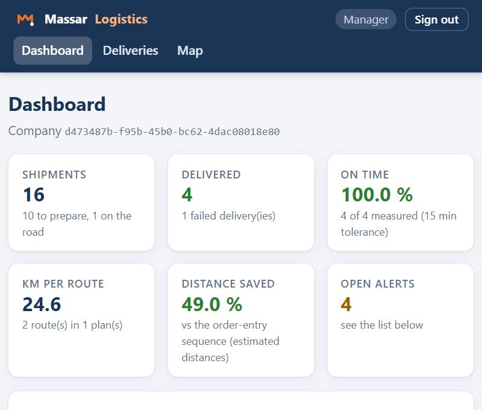
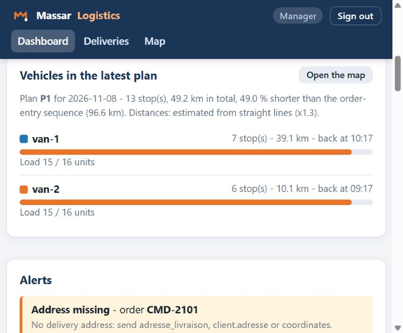
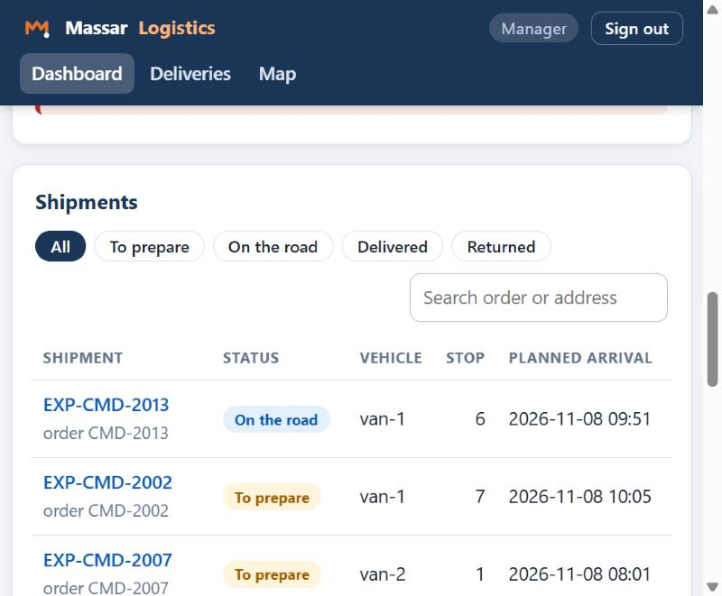
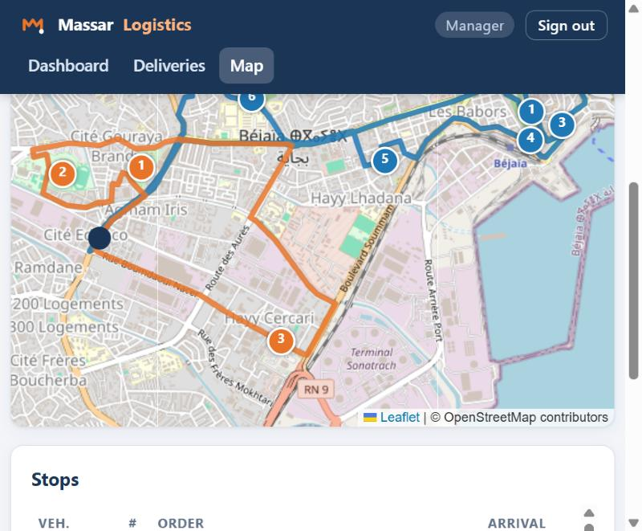
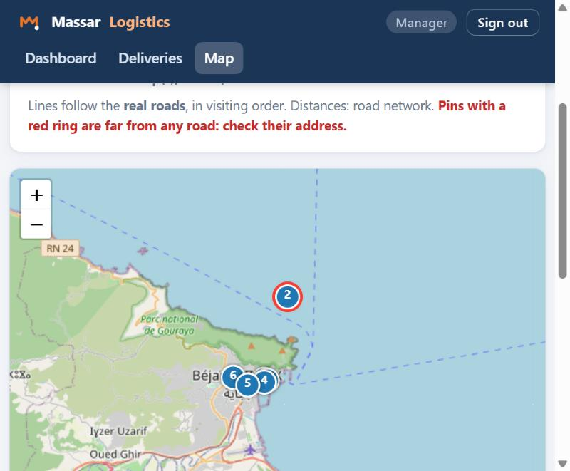
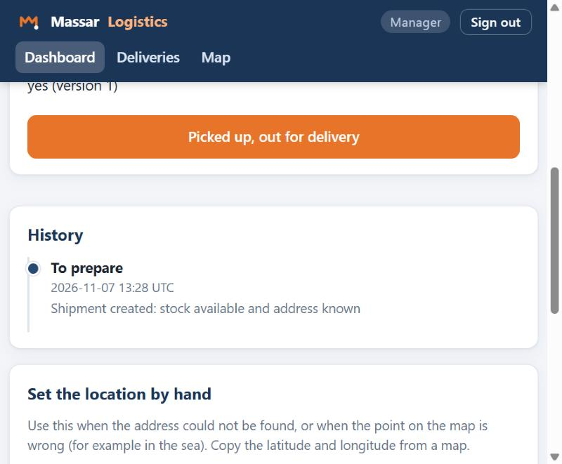
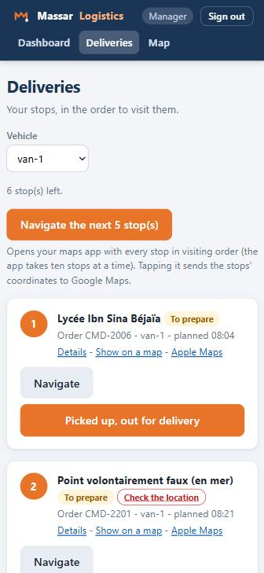

# User guide

For the **logistics manager** who plans the day and the **driver** who delivers. No technical knowledge needed. To understand what happens behind the screens, read [How the agent works](How-the-agent-works.md).

**Contents**

1. [Signing in](#1-signing-in)
2. [Manager: the dashboard](#2-manager-the-dashboard)
3. [Manager: planning the day](#3-manager-planning-the-day)
4. [Manager: alerts and what to do](#4-manager-alerts-and-what-to-do)
5. [Seeing the routes on the map](#5-seeing-the-routes-on-the-map)
6. [The shipment page](#6-the-shipment-page)
7. [Driver: doing the deliveries](#7-driver-doing-the-deliveries)
8. [A point is in the wrong place or in the sea](#8-a-point-is-in-the-wrong-place-or-in-the-sea)
9. [Questions and problems](#9-questions-and-problems)

---

## 1. Signing in

Your administrator gives you **two things**: a **company identifier** and an **access code**. Usually it is a ready-made link such as

`http://<agent-address>/ui/login?tenant=<company-identifier>`

that already fills in the identifier. Then you only type the code.

| Field | What to type |
|-------|--------------|
| **Company identifier** | The long code of your company, for example `3f8c2a10-5b7e-4c9d-8a21-6e0d94b7c5f2`. It is **not** the company's name. |
| **Access code** | Twelve letters and digits in three groups, for example `K7M2-9QXP-4WBN`. Capital letters, with or without dashes. |

There are two kinds of code: a **manager code** (opens the dashboard) and a **driver code** (opens the delivery list). After five wrong tries you must wait a minute. You stay signed in for twelve hours; use **Sign out** on a shared device.

> **Lost a code?** Ask the administrator to generate new ones. New codes replace the old ones.

---

## 2. Manager: the dashboard

The dashboard (`/ui`) is the manager's home page. It refreshes by itself every 15 seconds.

| Card | Meaning |
|------|---------|
| **Shipments** | All shipments, how many are still to prepare and how many are on the road |
| **Delivered** | Finished deliveries, and how many deliveries failed |
| **On time** | Share of deliveries made by their planned time (15 minutes of tolerance). Green from 90 %. |
| **km per route** | Average length of a planned route |
| **Distance saved** | How much shorter the plans are than visiting orders in the order they were entered |
| **Open alerts** | Things that need your attention (orange when above zero) |

Below the cards you find, in this order: **Plan the routes**, **Vehicles in the latest plan**, **Alerts**, and the **Shipments** list.

### The shipments list

- **Filter** with the buttons: *All*, *To prepare*, *On the road*, *Delivered*, *Returned*.
- **Search** by order number, shipment number or part of an address.
- The list shows shipments on the road first and delivered ones last.
- Click a **shipment number** to open its page.
- On a narrow screen, slide the table sideways to see every column.

---

## 3. Manager: planning the day

1. In **Plan the routes**, choose the **day to deliver** (today by default).
2. Press **Plan routes now**. It takes about three seconds.
3. Read the result:
   - a green message: *Plan P1 is ready*, with the number of stops, vehicles used, kilometres and the distance saved;
   - a red list if some shipments were **left out**, each with the reason in plain words;
   - an orange note if some stops are **far from any road**.
4. Press **See it on the map**, or look at **Vehicles in the latest plan**: each van with its stops, kilometres, the time it is back, and how full it is.

You can plan again at any time (for example after fixing an address). The newest plan is the one the drivers see.

> **Before the first plan** your company needs a **depot** (where routes start) in its settings. Without it the page says *No depot configured*; ask the administrator to add it.

An order that asks for a **later day**, and a delivery **rescheduled** after a failure, are not planned until their day.

---

## 4. Manager: alerts and what to do

Each alert says what happened and what to do about it.

| Alert | What it means | What to do |
|-------|---------------|------------|
| **Address missing** | The order has no address or coordinates | Add the delivery address to the order and send it again |
| **Address not found** | The address could not be found on the map | Correct the address, or set the location by hand on the shipment page |
| **Needs coordinates** | Address lookup is switched off or down | Send latitude and longitude, or set the location by hand |
| **Not enough stock** | The stock does not cover the order | Wait for stock, then send the order again |
| **Stock unknown** | There is no stock level for a product of the order | Publish the stock level from the stock dashboard |
| **Order not usable** | The order has no valid line (product and quantity) | Fix the order lines |
| **Not planned** | The shipment did not fit in a plan | Add a van or working hours, or deliver another day |
| **Suspicious location** | The point is far from any road (in the sea? a wrong address?) | Check the address or set the location by hand |
| **Running late** | A delivery is past its planned time by more than 15 minutes | Contact the driver |
| **Delivery failed** | A driver could not deliver | Reschedule, or contact the customer |

Alerts close by themselves when the problem is solved (for example, a delay alert closes when the delivery is made). Click **Open the shipment** under an alert to go straight to it.

---

## 5. Seeing the routes on the map

The **Map** page shows the latest plan on an OpenStreetMap background.

- Each **van has its own colour**; numbers show the **order of visit**; the dark dot is the **depot**.
- Tick or untick a van in the legend to **show or hide** its route.
- Click a **pin** for the order, address, planned arrival and a link to the shipment.
- Click a **row in the Stops list** and the map jumps to that pin (useful when pins overlap).
- Choose an **older plan** with the selector at the top right.
- A pin with a **red ring** is far from any road (a point in the sea, for example): check its address. The map frames the good stops so one wrong point never shrinks the whole map.

> **Real roads or straight lines?** When the road network is connected, the coloured lines **follow the real streets**, and the page says so above the map. When it is not, the lines simply join the stops in visiting order and are not the roads; drivers still follow the real roads with their phone's maps app (see [section 7](#7-driver-doing-the-deliveries)).

---

## 6. The shipment page

Open it from any shipment number. It shows everything about one delivery.

- **Details**: the order and client, the tracking number, the address and coordinates, its place in the plan, and whether the platform has been told about it.
- **History**: every step with the time (in UTC) and notes, newest first.
- **Actions**: *Picked up, out for delivery*, then *Delivered*, or *Delivery failed*.
- **Set the location by hand**: only while the shipment is still to prepare (see [section 8](#8-a-point-is-in-the-wrong-place-or-in-the-sea)).
- **Location**: a small map of the point.

If the order was delivered again after a failure, the page links to the **other shipments of the same order**.

---

## 7. Driver: doing the deliveries

Sign in with a **driver code**. You land on **Deliveries**: your stops in the order to visit them, as planned. The page is built for a phone: big buttons, and it refreshes by itself.

For each stop you see the number, the address, the order, the van and the planned time. Then:

- **Navigate** (grey button) opens your phone's **maps app** (Google Maps) with directions from where you are to that stop: roads, turns and the best way at that moment. **Apple Maps** has its own link for iPhones.
- **Navigate the next stops** (orange button at the top, once you choose one vehicle) opens the maps app with the next stops of your route **in visiting order**, up to ten at a time.
- A stop marked **Check the location** is far from any road: do not trust its point; open **Details** and correct it, or phone the manager. It is left out of the one-tap route.

Then, for each delivery:

1. **Picked up, out for delivery**: press it when you leave with the parcel. The stop turns blue (*On the road*).
2. **Delivered**: press it when the customer has the goods. The stop disappears from your list.
3. **Delivery failed**: press it if you cannot deliver.
   - Write the **reason** (required): *customer absent*, *wrong address*...
   - Optionally choose a **new day**. The delivery then comes back by itself on that day. Without a date, the manager decides what to do.
   - Confirm. The manager sees a *Delivery failed* alert with your reason.

Other helpful things:

- **Details** opens the shipment page; **Show on a map** opens the point in OpenStreetMap.
- Tapping a Navigate button sends that stop's coordinates to Google (or Apple) Maps, like any map link.
- With several vans, use the **Vehicle** selector to see only yours.
- If you made a mistake, tell the manager: a delivered stop cannot be reopened.

---

## 8. A point is in the wrong place or in the sea

Sometimes a pin lands on the wrong spot, even in the sea. The map shows exactly the coordinates the agent has, so the coordinates are wrong. Common causes: a typo in the order, an address that is too vague and matched a similarly named place, or test data.

**To fix it** (manager or driver):

1. Open the shipment page (click the pin, then *Open the shipment*, or use the list).
2. Open a map such as OpenStreetMap, find the real place, and copy the **latitude** and **longitude** (right-click the point on the map to see them).
3. In **Set the location by hand**, type them and press **Save**. Use a dot or a comma for decimals.
4. The alerts about that order close. Press **Plan routes now** again so the plans use the new point.

Latitude is between -90 and 90 and longitude between -180 and 180. For Béjaïa they are around **36.75** and **5.06**. If you type something impossible, the page tells you what is wrong and changes nothing. The location can only be changed while the shipment is still **to prepare**.

---

## 9. Questions and problems

**I cannot sign in.** Check that you typed the company *identifier* (the long code), not the company name. Check the code letter by letter (no `0`, `O`, `1` or `I` are used in codes). After five wrong tries, wait one minute. If it still fails, ask for new codes.

**The page keeps sending me back to the sign-in page.** Your session ended (twelve hours), or your company was deactivated. Sign in again.

**There is no shipment for an order.** Open the alerts: the order is probably blocked (no address, no stock, invalid lines). Orders that are not *confirmed* yet are waiting, without an alert.

**"No depot configured" when planning.** The company has no starting point yet. The administrator adds a `depot` to the company settings.

**A shipment is missing from the plan.** The plan result lists every shipment left out, with the reason. Typical causes: no coordinates yet, the load is bigger than every van, or all vans are full.

**The plan says "estimated from straight lines".** The road network is not connected, so distances are estimates (straight lines plus 30 %). Routes are still sensible, but the times and kilometres are approximate.

**Distance saved looks huge.** It compares with visiting orders in the order they were entered. If addresses are scattered, that is a very poor route, so the saving is large. Real saving depends on how scattered your orders are.

**I cannot open the page from my phone.** `localhost` on a phone is the phone itself. Use the address of the computer that runs the agent (for example `http://192.168.1.20:9000`). Both devices must be on the same network, and some public Wi-Fi networks (libraries, schools) block devices from reaching each other: use a hotspot instead.

**The map is blank or the page looks unstyled.** The browser needs internet access to load the map tiles and a small script library. Check the connection and reload.

**I changed something but the list did not change.** Lists refresh every 15 to 30 seconds; actions refresh immediately. Reload the page if in doubt.

For anything else, see [How the agent works](How-the-agent-works.md) or ask your administrator.
